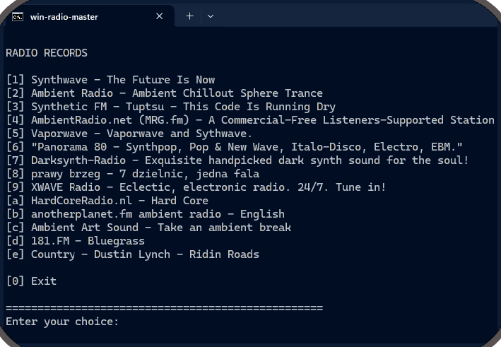

# win-radio-master

A batch script for Windows that records internet radio streams. You pick a station from a menu, and [streamripper](https://github.com/streamripper/streamripper) does the recording, saving each stream into a dated folder. The whole thing is one `.bat` file, so there's nothing to build or install besides streamripper itself.

<p align="left">
  
</p>

> [!WARNING]
> Only use this to record content that isn't protected by copyright.

## Requirements

- Windows
- [streamripper](https://sourceforge.net/projects/streamripper/files/), installed in its default location (`C:\Program Files (x86)\streamripper\`)

You don't have to install streamripper first. If the script can't find it, it opens the download page for you.

## Quick start

```bash
git clone https://github.com/Avidei/win-radio-master.git
cd win-radio-master
```

Double-click `win-radio-master.bat`.

1. On the first run a folder picker asks where to save recordings. The choice is stored in `%userprofile%\radio_save_dir`.
2. If streamripper is missing, the download page opens. Close the Command Prompt, run the installer (`streamripper-windows-installer-<version>.exe`), then start the script again.
3. Press the key for a station and hit Enter. The stream opens in your default browser and recording starts.
4. Close the Command Prompt window to stop.

## How it behaves

- Recordings go to `<your save dir>\YYYY-MM-DD_-_HH-MM`, so every session gets its own folder named after the start time.
- If the stream drops or streamripper exits, the script starts it again on the same station. That also means a new folder and a new browser tab each time.
- streamripper runs with a relay on `127.0.0.1:800`. If you'd rather listen in a player than the browser, point it at `http://127.0.0.1:800`.
- Pressing anything that isn't in the menu closes the script. `0` exits cleanly.
- The save-folder picker works through a small temporary file, `browse_dir.js`, which the script creates and removes itself.

## Stations

| Key | Station |
|-----|---------|
| 1 | Synthwave: The Future Is Now |
| 2 | Ambient Radio: Ambient Chillout Sphere Trance |
| 3 | Synthetic FM |
| 4 | AmbientRadio.net (MRG.fm) |
| 5 | Vaporwave |
| 6 | Panorama 80: synthpop, new wave, italo-disco, electro, EBM |
| 7 | Darksynth-Radio |
| 8 | prawy brzeg |
| 9 | XWAVE Radio |
| a | HardCoreRadio.nl |
| b | anotherplanet.fm ambient radio |
| c | Ambient Art Sound |
| d | 181.FM Bluegrass |
| e | Country: Dustin Lynch, Ridin Roads |
| 0 | Exit |

## Adding your own stations

Open the `.bat` in a text editor. A new station needs three small edits. `{symbol}` is a single character you'll press to select it.

1. In the menu section (under `:: TITLE`), add a line:
   ```batch
   echo [{symbol}] {station name}
   ```
2. In the list under `:: CHECK`, add `"{symbol}"` as another entry.
3. In the list under `:: URL`, add:
   ```batch
   IF %startradio%=={symbol} SET url="{stream url}"
   ```

Use the direct stream URL, not the station's web page. If you only have an `.m3u` or `.pls` playlist, open it in a text editor and copy the address from inside.

## Settings you might want to change

**Save folder.** The script remembers it in a hidden file. To pick a new one, delete the file and run the script again:

```batch
del /a:h "%userprofile%\radio_save_dir"
```

**User-agent.** Some streams only answer to certain clients, so the script identifies itself as VLC. It's the `ua` line near the bottom:

```batch
SET ua="VLC/2.2.6 LibVLC/2.2.6"
```

## Troubleshooting

**`error -6 [SR_ERROR_CANT_RESOLVE_HOSTNAME]`**

```text
error -6 [SR_ERROR_CANT_RESOLVE_HOSTNAME]
bye..
shutting down
```

The usual cause is the user-agent: with a VLC string like the one above the stream works. If you've changed the `ua` line, put the original back. If it still fails, check that you're online and that the station's stream URL is still alive.

**Wrong or broken folder names.** The folder name is built by slicing the system date string, so it assumes the `dd.mm.yyyy` format. With a different regional date format (for example `mm/dd/yyyy`) the names can come out wrong or the script can misbehave. Switching the Windows date format to `dd.mm.yyyy` fixes it.

**The folder picker doesn't appear or the saved path is garbled.** Delete `radio_save_dir` as shown above and run the script again.

## License

GNU General Public License v3.0. See the [license text](https://www.gnu.org/licenses/gpl-3.0.html).
